# p-simtor

**An agent skill for Claude Code, Codex and OpenCode that turns a plain-language request into an interactive physics simulation: computed from the real equations, checked for accuracy, and delivered as one HTML file.**

### ▶ [Open the live demo gallery](https://janosvajda.github.io/p-simtor/)

Ask your coding agent for something like *"recreate Rutherford's gold foil experiment in 3D"* or *"show a Bose–Einstein condensate being stirred until vortices appear"*. With this skill the agent:

1. **checks the request** and corrects wrong premises (the reply always starts with a *Fact check* line);
2. **chooses the model and method**: the governing equations, a suitable numerical method, and what should be shown;
3. **computes the physics**: nothing is a made-up animation, and changing a parameter re-solves the model;
4. **measures the accuracy** against exact solutions, published results and measurements, and embeds that evidence in the page;
5. **delivers one HTML file** that runs offline in any modern browser, with **WebGL 3D scenes** where they help, a **full-screen** mode, controls, live diagnostics and the equations.

## Quick start

**1. Install** (needs [Node.js](https://nodejs.org) 22 or later):

Choose one of these three sources. Run the command for your agent.

**Option A: Install from the original GitHub repository**

These commands install from the repository's default branch:

| Agent | Command |
|---|---|
| Claude Code | `npx skills add janosvajda/p-simtor -a claude-code` |
| Codex | `npx skills add janosvajda/p-simtor -a codex` |
| OpenCode | `npx skills add janosvajda/p-simtor -a opencode` |

To choose a specific branch, use its GitHub URL as the source. For example, for Codex:

```bash
npx skills add https://github.com/janosvajda/p-simtor/tree/main -a codex
```

Replace `main` with the branch you want. Use `-a claude-code` or `-a opencode` for those agents. The installer downloads the skill for you; you do not need a local clone.

**Option B: Fork on GitHub, then install from your own repository**

Click **Fork** on [janosvajda/p-simtor](https://github.com/janosvajda/p-simtor) to create your own GitHub copy. Install from that copy by replacing `<owner>` below with your GitHub username or organisation:

| Agent | Command |
|---|---|
| Claude Code | `npx skills add "https://github.com/<owner>/p-simtor" -a claude-code` |
| Codex | `npx skills add "https://github.com/<owner>/p-simtor" -a codex` |
| OpenCode | `npx skills add "https://github.com/<owner>/p-simtor" -a opencode` |

To install a specific branch of your fork, replace both `<owner>` and `<branch>` in this example:

```bash
npx skills add "https://github.com/<owner>/p-simtor/tree/<branch>" -a codex
```

Again, choose the `-a` value for your agent. If you renamed your fork, also replace `p-simtor` with its repository name. This installs the files published in your fork and chosen branch, without needing a local clone.

**Option C: Install from an existing local folder**

Use this for a local clone, an extracted ZIP, or a working copy with local edits. Replace `/path/to/p-simtor` with its actual path. The installer uses the files currently on your computer, including changes you have not published to GitHub.

| Agent | Command |
|---|---|
| Claude Code | `npx skills add /path/to/p-simtor -a claude-code` |
| Codex | `npx skills add /path/to/p-simtor -a codex` |
| OpenCode | `npx skills add /path/to/p-simtor -a opencode` |


Example: if you created a new directory p-simtor-test, and you have p-simtor locally checkouted, you can run something like this in p-simtor-test dir:

`npx skills add ../p-simtor -a claude-code`

If you have not installed skills it will install that dependency.

If you are already inside that folder, use `.` as the source, for example `npx skills add . -a codex`.

All three options install into the current project. Run the command from your target project's folder and use the GitHub URL or the path to the skill folder. Quote local paths that contain spaces. No API keys needed.

More installer options: [skills CLI documentation](https://github.com/vercel-labs/skills#source-formats).

**2. Start a new session** of your coding agent, so it picks up the skill.

**3. Ask for a simulation:**

| Agent | Type this |
|---|---|
| Claude Code | `/p-simtor show why galaxies need dark matter` |
| Codex | `$p-simtor show why galaxies need dark matter` (or pick it from `/skills`) |
| OpenCode | `/p-simtor show why galaxies need dark matter` |

You can also just describe what you want ("simulate the planets orbiting the Sun"): the agent uses the skill automatically when a request is about physics.

**4. Open the result.** The agent ends its answer with a link to the page (in `simulations/` in your project) and offers to open it in your browser.

## Demos

The demos were generated in a separate project with the skill installed. They are computed live in your browser; nothing is pre-recorded video. Apart from being rebuilt with the latest runtime, they are published as generated, except for one correction: a slider hint in the 4D lattice demo wrongly said that single gauge links approach the identity.

<!-- demos:start -->

**27 demos**, each made by an agent from the single prompt under it (17 of them are WebGL scenes). Click a picture to run it in your browser.

### Famous experiments, recreated (6)

<table>
<tr><td width="33%" valign="top"><a href="https://janosvajda.github.io/p-simtor/double-slit-electrons.html"></a><br><b><a href="https://janosvajda.github.io/p-simtor/double-slit-electrons.html">Double slit, one electron at a time</a></b> <sup>WebGL</sup><br><code>/p-simtor show the double-slit experiment with single electrons, where the interference pattern builds up one electron at a time</code></td><td width="33%" valign="top"><a href="https://janosvajda.github.io/p-simtor/rutherford-gold-foil.html"></a><br><b><a href="https://janosvajda.github.io/p-simtor/rutherford-gold-foil.html">Rutherford's gold foil experiment</a></b> <sup>WebGL</sup><br><code>/p-simtor recreate Rutherford's gold foil experiment in 3D: alpha particles hitting a gold foil, and show why it proved the atom has a tiny nucleus</code></td><td width="33%" valign="top"><a href="https://janosvajda.github.io/p-simtor/stern-gerlach-3d.html"></a><br><b><a href="https://janosvajda.github.io/p-simtor/stern-gerlach-3d.html">Stern–Gerlach in 3D</a></b> <sup>WebGL</sup><br><code>/p-simtor simulate the Stern–Gerlach experiment in 3D, including several magnets in a row, to show that spin is quantised</code></td></tr>
<tr><td width="33%" valign="top"><a href="https://janosvajda.github.io/p-simtor/bubble-chamber-3d.html"></a><br><b><a href="https://janosvajda.github.io/p-simtor/bubble-chamber-3d.html">Bubble chamber: π → μ → e</a></b> <sup>WebGL</sup><br><code>/p-simtor make a 3D bubble chamber: charged particles curling in a magnetic field, with a pion decaying into a muon and then an electron</code></td><td width="33%" valign="top"><a href="https://janosvajda.github.io/p-simtor/bec-vortex-lattice.html">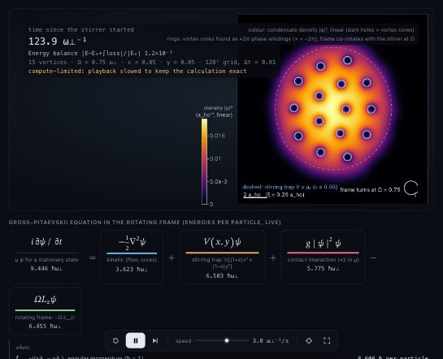</a><br><b><a href="https://janosvajda.github.io/p-simtor/bec-vortex-lattice.html">Stirred condensate: vortex lattice</a></b> <sup>WebGL</sup><br><code>/p-simtor show a Bose–Einstein condensate being stirred until quantum vortices appear and form a lattice</code></td><td width="33%" valign="top"><a href="https://janosvajda.github.io/p-simtor/cavendish-experiment-3d.html">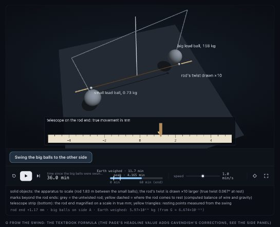</a><br><b><a href="https://janosvajda.github.io/p-simtor/cavendish-experiment-3d.html">Cavendish experiment: weighing the Earth</a></b> <sup>WebGL</sup><br><code>/p-simtor recreate the Cavendish experiment in 3D: weighing the Earth with a torsion balance</code></td></tr>
</table>

### Space and gravity (4)

<table>
<tr><td width="33%" valign="top"><a href="https://janosvajda.github.io/p-simtor/galaxy-collision.html"></a><br><b><a href="https://janosvajda.github.io/p-simtor/galaxy-collision.html">Two galaxies colliding</a></b> <sup>WebGL</sup><br><code>/p-simtor simulate two galaxies colliding</code></td><td width="33%" valign="top"><a href="https://janosvajda.github.io/p-simtor/black-hole-inspiral-3d.html">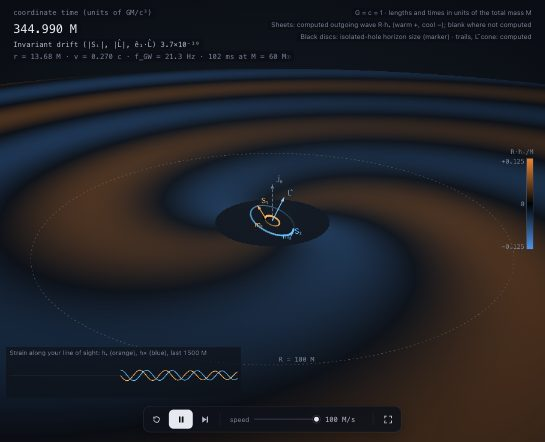</a><br><b><a href="https://janosvajda.github.io/p-simtor/black-hole-inspiral-3d.html">Black-hole binary inspiral in 3D</a></b> <sup>WebGL</sup><br><code>/p-simtor show two black holes spiralling together in 3D</code></td><td width="33%" valign="top"><a href="https://janosvajda.github.io/p-simtor/dark-matter-galaxy-3d.html">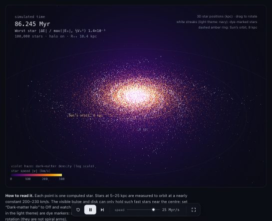</a><br><b><a href="https://janosvajda.github.io/p-simtor/dark-matter-galaxy-3d.html">Why galaxies need dark matter</a></b> <sup>WebGL</sup><br><code>/p-simtor show why galaxies need dark matter, with a 3D galaxy of 100 000 stars</code></td></tr>
<tr><td width="33%" valign="top"><a href="https://janosvajda.github.io/p-simtor/black-hole-merger.html">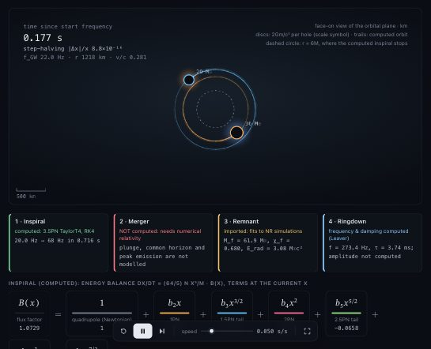</a><br><b><a href="https://janosvajda.github.io/p-simtor/black-hole-merger.html">Binary black-hole merger</a></b><br><code>/p-simtor simulate two black holes merging</code></td></tr>
</table>

### Particle physics and 4D gauge theory (7)

<table>
<tr><td width="33%" valign="top"><a href="https://janosvajda.github.io/p-simtor/qcd-vacuum-4d-slices.html"></a><br><b><a href="https://janosvajda.github.io/p-simtor/qcd-vacuum-4d-slices.html">Instantons in the 4D lattice vacuum</a></b> <sup>WebGL</sup><br><code>/p-simtor visualise the 4D vacuum of a lattice gauge theory: show instantons as you move through Euclidean time, slice by slice</code></td><td width="33%" valign="top"><a href="https://janosvajda.github.io/p-simtor/quark-confinement.html">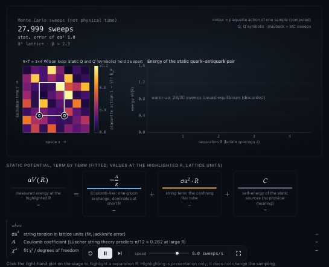</a><br><b><a href="https://janosvajda.github.io/p-simtor/quark-confinement.html">Quark confinement</a></b><br><code>/p-simtor explain quark confinement with an interactive, scientifically qualified visualization</code></td><td width="33%" valign="top"><a href="https://janosvajda.github.io/p-simtor/su2-three-sphere.html">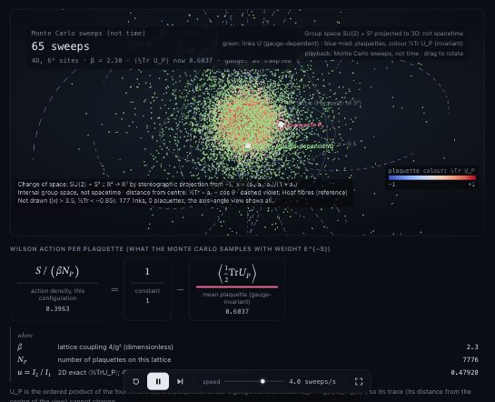</a><br><b><a href="https://janosvajda.github.io/p-simtor/su2-three-sphere.html">SU(2) gauge field on the 3-sphere</a></b> <sup>WebGL</sup><br><code>/p-simtor show the SU(2) gauge field as points on the 3-sphere in 4D</code></td></tr>
<tr><td width="33%" valign="top"><a href="https://janosvajda.github.io/p-simtor/lattice-4d-projection.html">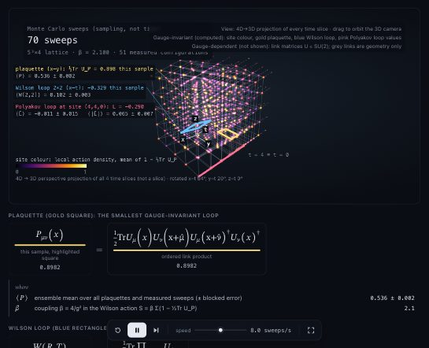</a><br><b><a href="https://janosvajda.github.io/p-simtor/lattice-4d-projection.html">4D gauge lattice, projected</a></b> <sup>WebGL</sup><br><code>/p-simtor show a 4D spacetime lattice of a gauge theory, with links, plaquettes, a Wilson loop and a Polyakov loop, by rotating it in 4D</code></td><td width="33%" valign="top"><a href="https://janosvajda.github.io/p-simtor/asymptotic-freedom.html">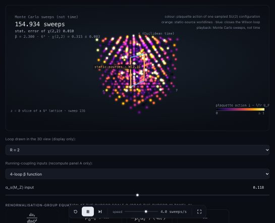</a><br><b><a href="https://janosvajda.github.io/p-simtor/asymptotic-freedom.html">Asymptotic freedom and the strong force</a></b> <sup>WebGL</sup><br><code>/p-simtor show asymptotic freedom and the strong force</code></td><td width="33%" valign="top"><a href="https://janosvajda.github.io/p-simtor/yang-mills-mass-gap.html">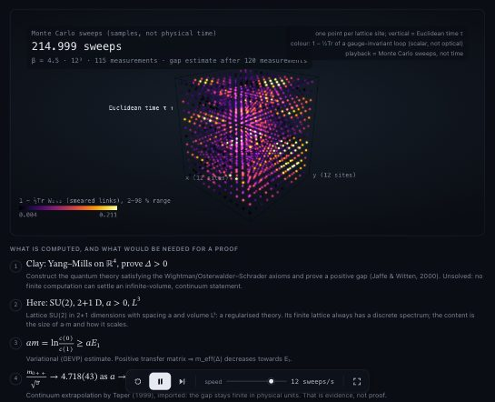</a><br><b><a href="https://janosvajda.github.io/p-simtor/yang-mills-mass-gap.html">Yang–Mills mass gap: lattice evidence</a></b> <sup>WebGL</sup><br><code>/p-simtor prove the Yang-Mills existence and mass gap</code></td></tr>
<tr><td width="33%" valign="top"><a href="https://janosvajda.github.io/p-simtor/weak-force.html">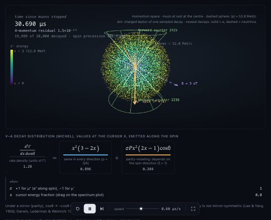</a><br><b><a href="https://janosvajda.github.io/p-simtor/weak-force.html">The weak interaction: polarised muon decay</a></b> <sup>WebGL</sup><br><code>/p-simtor simulate the weak force</code></td></tr>
</table>

### Quantum mechanics (3)

<table>
<tr><td width="33%" valign="top"><a href="https://janosvajda.github.io/p-simtor/hydrogen-orbitals-3d.html">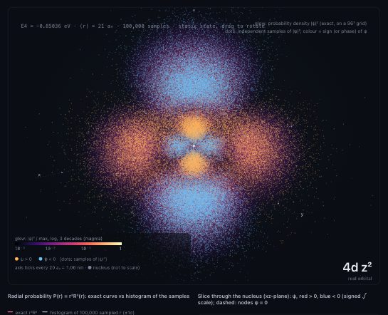</a><br><b><a href="https://janosvajda.github.io/p-simtor/hydrogen-orbitals-3d.html">Hydrogen orbitals in 3D</a></b> <sup>WebGL</sup><br><code>/p-simtor visualize the 3D probability clouds of hydrogen orbitals</code></td><td width="33%" valign="top"><a href="https://janosvajda.github.io/p-simtor/wave-packet-tunnelling.html">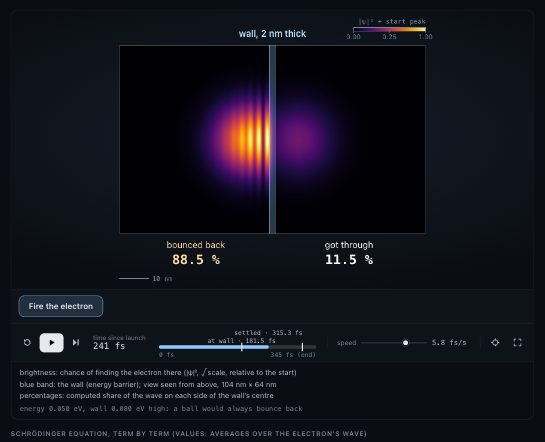</a><br><b><a href="https://janosvajda.github.io/p-simtor/wave-packet-tunnelling.html">Electron wave packet tunnelling in 2D</a></b> <sup>WebGL</sup><br><code>/p-simtor show an electron wave packet tunnelling through a barrier in 2D</code></td><td width="33%" valign="top"><a href="https://janosvajda.github.io/p-simtor/three-level-thermal.html">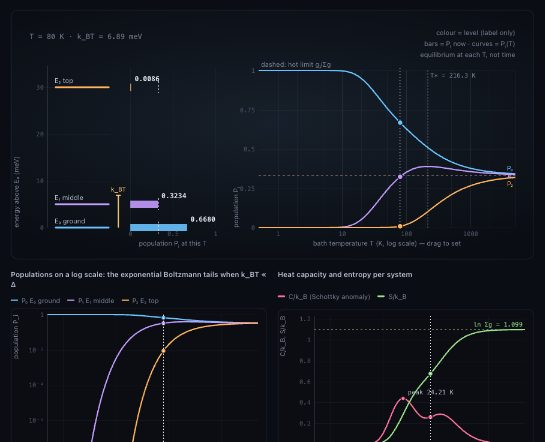</a><br><b><a href="https://janosvajda.github.io/p-simtor/three-level-thermal.html">Three-level system heating up</a></b><br><code>/p-simtor show how the populations of a three-level quantum system change as it heats up</code></td></tr>
</table>

### Heat, matter and chaos (7)

<table>
<tr><td width="33%" valign="top"><a href="https://janosvajda.github.io/p-simtor/black-body.html">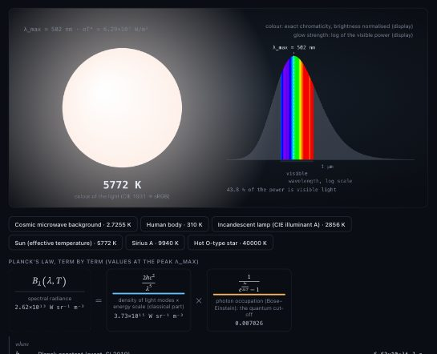</a><br><b><a href="https://janosvajda.github.io/p-simtor/black-body.html">Black-body radiation</a></b><br><code>/p-simtor simulate black body radiation</code></td><td width="33%" valign="top"><a href="https://janosvajda.github.io/p-simtor/double-pendulum.html">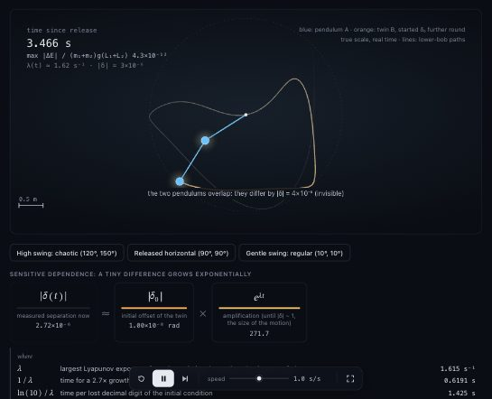</a><br><b><a href="https://janosvajda.github.io/p-simtor/double-pendulum.html">Why a double pendulum is chaotic</a></b><br><code>/p-simtor show why a double pendulum is chaotic</code></td><td width="33%" valign="top"><a href="https://janosvajda.github.io/p-simtor/lennard-jones.html">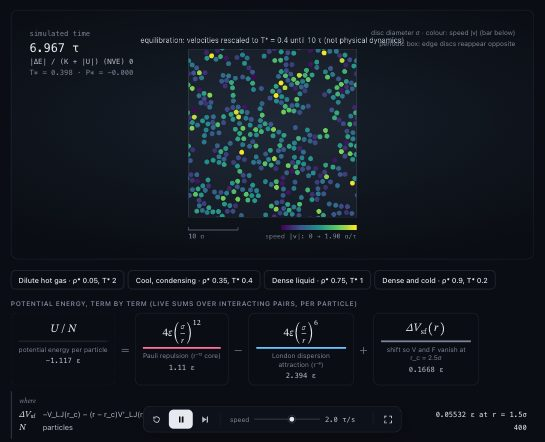</a><br><b><a href="https://janosvajda.github.io/p-simtor/lennard-jones.html">Lennard-Jones fluid (2D)</a></b><br><code>/p-simtor create an interactive Lennard-Jones particle simulation</code></td></tr>
<tr><td width="33%" valign="top"><a href="https://janosvajda.github.io/p-simtor/brownian-motion.html">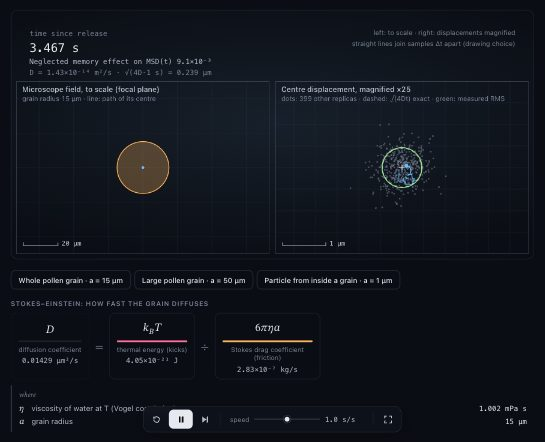</a><br><b><a href="https://janosvajda.github.io/p-simtor/brownian-motion.html">Brownian motion of a pollen grain</a></b><br><code>/p-simtor simulate Brownian motion of a pollen grain in water</code></td><td width="33%" valign="top"><a href="https://janosvajda.github.io/p-simtor/magnet-heating.html">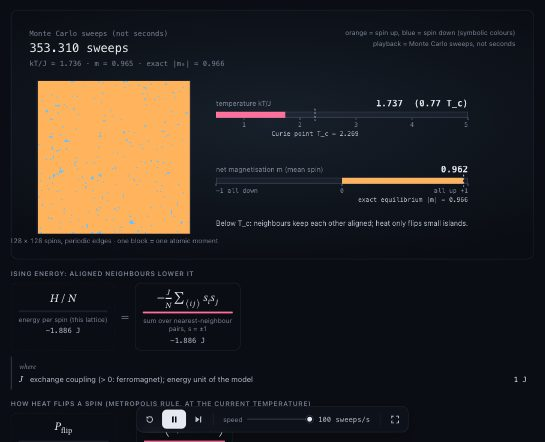</a><br><b><a href="https://janosvajda.github.io/p-simtor/magnet-heating.html">Heating a magnet</a></b><br><code>/p-simtor show how a magnet loses its magnetism when heated</code></td><td width="33%" valign="top"><a href="https://janosvajda.github.io/p-simtor/decay-chain.html">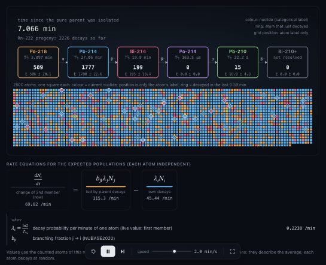</a><br><b><a href="https://janosvajda.github.io/p-simtor/decay-chain.html">Radioactive decay chain, atom by atom</a></b><br><code>/p-simtor simulate a radioactive decay chain atom by atom</code></td></tr>
<tr><td width="33%" valign="top"><a href="https://janosvajda.github.io/p-simtor/salt-dissolving.html">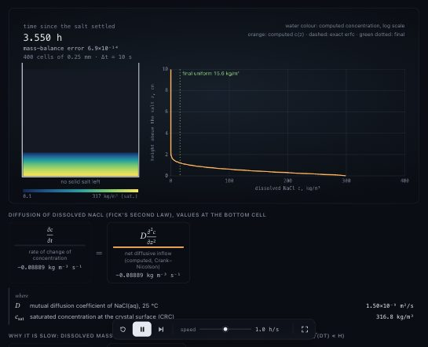</a><br><b><a href="https://janosvajda.github.io/p-simtor/salt-dissolving.html">Salt dissolving in still water</a></b><br><code>/p-simtor simulate how salt dissolves in a glass of water</code></td></tr>
</table>

<!-- demos:end -->

### ▶ [Open the gallery](https://janosvajda.github.io/p-simtor/)

## WebGL 3D, full screen and speed

- **GPU scenes** (`ui/gl.mjs`, WebGL2): glowing point clouds of 10⁵–10⁶ stars or samples, lit spheres with exact silhouettes, thick 3D lines and tracks, colour-mapped 2D fields, ray-marched 3D volumes (orbitals, densities, signed fields), and solid objects with shadows. Labels, axes and readouts stay on a sharp 2D layer on top.
- **Full screen** on every page: the button at the right end of the playback bar, or the **F** key (Esc leaves). On phones without the Fullscreen API the scene fills the window.
- **Smooth on big screens:** the 3D layer lowers its resolution automatically when the GPU falls behind (large or full-screen windows) and raises it again when there is headroom; volumes are ray-marched at reduced resolution and upscaled. On a 2560×1440 Retina screen the gallery's 3D demos run at about 55–60 fps, also in full screen.
- **No WebGL?** The page says so and keeps its 2D figures, readouts and verification.

## What every simulation includes

- **Real computation.** Changing a mass, field or temperature re-solves the model; it never just changes the animation.
- **A trust label:** *Validated numerical*, *Approximate numerical*, *Analytical* or *Conceptual illustration*, with the reason.
- **A verification report** measured when the page was built: accuracy against exact or published results, convergence, conservation laws, statistical tests.
- **Live diagnostics** while it runs, for example energy conservation or a probability budget.
- **The maths:** equations split into their physical terms with live values, plus the assumptions and limits.
- **Controls:** play, pause, step, playback speed, parameter sliders, presets ("Try this"), full screen, light and dark themes, phone layout.
- **Export:** data as CSV or JSON, the picture as PNG.

## What the agent can start from

Any subject goes through the same workflow: scientific question → sourced model → computed observables → visual meaning → suitable method → evidence. It asks when an ambiguity or a simplification would change the scientific answer, and it says when something cannot be computed in a browser (for example, it will not claim to *prove* the Yang–Mills mass gap, but it will measure it on a lattice).

| Area | What ships |
|---|---|
| Gravity: planets, three-body, N-body, galaxies, dark matter | Verified recipes and solvers (NASA/JPL data, conservation and benchmark checks) |
| Relativity and black holes: GPS clocks, light bending, shadows and lensing | Verified recipes (GPU ray tracing for the black-hole image) |
| Quantum mechanics: orbitals, wave packets, double slit, spin, condensates | Tested solvers: split-operator Schrödinger in any dimension, stationary states, spin ½, probability current, vortex detection |
| Particle physics: decays, detectors, the weak and strong forces | Relativistic kinematics and phase space, Bethe energy loss, PDG particle data, QCD running coupling |
| Lattice gauge theory and 4D views | SU(2) Monte Carlo, Wilson and Polyakov loops, smearing, gauge fixing, instanton topology, 4D projections and S³ maps |
| Heat, chemistry and statistics | Molecular dynamics, Langevin and Gillespie dynamics, Monte Carlo sampling, diffusion, jackknife/bootstrap errors, curve fitting |
| Anything else | The general workflow plus the [math toolkit](references/math-toolkit.md): ODEs, PDEs, linear algebra, FFTs, special functions |

## Requirements

- Node.js 22 or later.
- Chrome or Chromium for the automatic browser checks (set `CHROME_PATH` if it isn't in a standard location). Without it, simulations still work; the agent reports that the browser check was skipped.
- Generated pages run in any modern browser. 3D scenes need WebGL2 (all current desktop and mobile browsers).

## Adding demos to the gallery

`docs/` is a static gallery of **real demos**: pages that the installed skill produced in a separate project from a real prompt. Nothing in this repository builds them.

1. In a project with the skill installed, ask for a simulation, e.g. `/p-simtor show why galaxies need dark matter`.
2. If the result is good, add it from this repository:
   ```bash
   node scripts/gallery.mjs add ~/my-project/simulations/galaxy-dark-matter.html \
     --prompt "/p-simtor show why galaxies need dark matter" \
     --about "one line on what it shows" --group space
   ```
   This copies the page into `docs/`, takes a thumbnail, records the prompt and date, and updates the demo list in this README. Groups: `experiments`, `space`, `particles`, `quantum`, `matter`. For a better thumbnail, `--advance T` fast-forwards to time T and `--click "+10 000"` presses a page button first. `list`, `remove <id>` and `order <id> …` manage the gallery.
3. To publish: push, then in GitHub open **Settings → Pages** and deploy from branch `main`, folder `/docs`.

## Verification status

| Claim | Status |
|---|---|
| `npx skills add` installs the skill from a local copy for Claude Code, Codex and OpenCode | Verified in a fresh project |
| Claude Code discovers `/p-simtor` and builds working pages from a single prompt | Verified: every demo in the gallery |
| Codex (`$p-simtor`) and OpenCode (`/p-simtor`) | Skill folders as documented by each agent; not yet tested |
| `npx skills add janosvajda/p-simtor` from GitHub | Not yet tested |

---

## For contributors

### How it works

```
SKILL.md                 what the agent reads: workflow, recipes, rules, trust labels
references/              loaded on demand: method selection, verification, visual language, physics notes
examples/                verified recipes (physics.mjs + page.html + built page), catalog.json
core/                    physics and maths, plain ES modules that run in Node and the browser
  numerics.mjs           RNG, FFT, ODE steps, quadrature, roots, special functions, incomplete gamma
  linalg.mjs             dense solves, QR, symmetric and generalised eigenproblems, Cholesky, CG, Newton, expm
  fields.mjs             ND derivatives and FFTs, Poisson, diffusion, Schrödinger, probability current, vortices
  ode.mjs, pde.mjs       adaptive/symplectic steppers with events; diffusion with walls, waves, stationary states
  particles.mjs          composable forces, periodic boxes, interacting bodies
  probability.mjs, stochastic.mjs, data.mjs   equilibrium, sampling, dynamics, statistics and fits
  kinematics.mjs, matter.mjs, spin.mjs, qcd.mjs   4-vectors and phase space, energy loss, spin ½, α_s running
  lattice-gauge.mjs, projection.mjs           SU(2) lattice gauge theory; 4D and S³ projections
  nbody.mjs, solar-system.mjs, galaxy.mjs, schwarzschild.mjs, relativity.mjs, radiation.mjs, sun.mjs
  constants.mjs          CODATA, IAU, PDG particle data, IUPAC atomic weights
ui/                      page shell (full screen, adaptive GPU resolution), WebGL renderers, plots, equations
scripts/psim.mjs         tool the agent runs: recipes, new, build, verify-module, check, node, open
scripts/gallery.mjs      maintainers: add real demos to docs/ and keep this README's list in sync
tests/                   300+ automated tests (node:test) and a browser fixture with GPU pixel checks
```

### Design decisions

- **Plain JavaScript, no runtime dependencies.** The same modules compute the physics in tests and in the bundled page.
- **Model selection first.** The agent chooses the mathematics and observables, then reuses suitable numerical tools and matching recipes. The [math toolkit](references/math-toolkit.md) documents usable imports and their limits for unfamiliar subjects.
- **Measured, not assumed.** Every page carries a verification report; `psim check` loads it in headless Chrome (dark, light and phone views), drives the controls, checks every mode with `--params`, and types extreme values into every input to make sure nothing freezes or breaks.
- **Self-contained pages.** Everything is inlined into one HTML file, with nothing loaded from the internet.

### Development

Using the skill needs nothing installed. Working **on** it uses ESLint as a dev-only tool:

```bash
npm install            # dev tools only (ESLint)
npm run check          # lint + all tests
npm run test:browser   # rebuild the recipe pages and run the browser checks (GPU pixel tests included)
```

The tests compare every module with exact solutions, published values and measurements (Earth's year, Mercury's perihelion advance, light bending at the Sun, the M87* image size, GPS clock drift, the CMB, hydrogen's Balmer-α line, PDG minimum ionisation, the BPST instanton charge, and more), and check that built pages behave exactly like their sources.

## License

MIT
