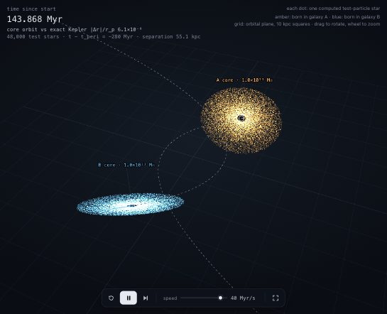
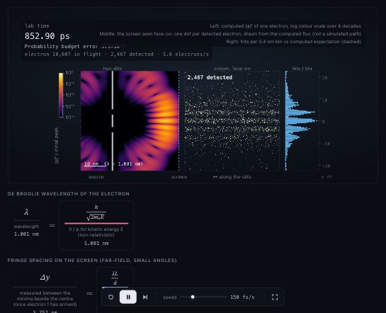
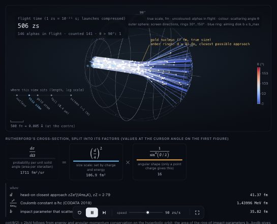
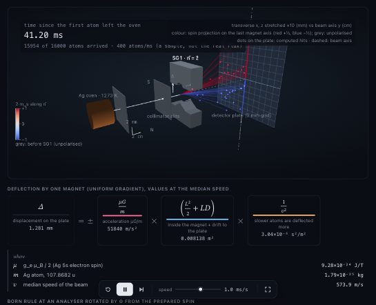
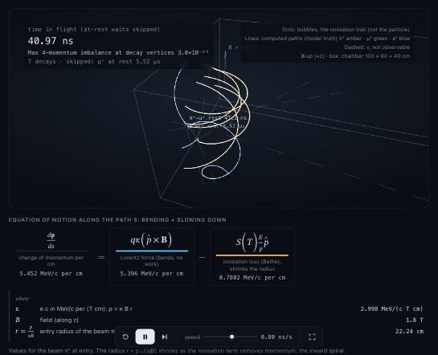
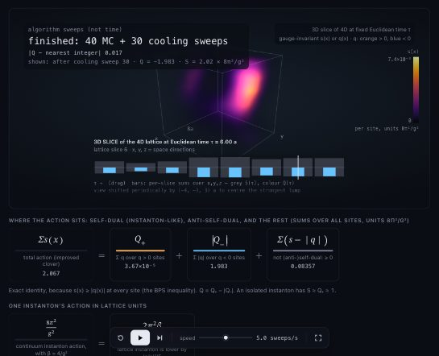

# p-simtor

**An agent skill for Claude Code, Codex and OpenCode that builds interactive physics simulations, computed from the real equations and checked for accuracy.**

### ▶ [See the live demos](https://janosvajda.github.io/p-simtor/)

Every demo in the gallery was made by an agent from a single prompt, and runs in your browser.

Describe a physical system in plain words: planets, a black hole, a galaxy, a charged particle, thermal radiation. Your coding agent then:

1. picks the governing theory and a suitable numerical method,
2. computes the physics (it never animates made-up motion),
3. measures how accurate the result is, against exact solutions and real measurements,
4. delivers **one HTML file** that opens in any browser, works offline, and lets you change the parameters and watch the physics respond.

Every page shows its own evidence: live error diagnostics, a verification report, the equations, and the model's assumptions and limits.

## Quick start

**1. Install** (needs [Node.js](https://nodejs.org) 22 or later):

Choose one of these three sources. Run the command for your agent.

**Option A: Install from the original GitHub repository**

These commands install from the repository's default branch:

| Agent | Command |
|---|---|
| Claude Code | `npx skills add janosvajda/p-simtor -a claude-code` |
| Codex | `npx skills add janosvajda/p-simtor -a codex` |
| OpenCode | `npx skills add janosvajda/p-simtor -a opencode` |

To choose a specific branch, use its GitHub URL as the source. For example, for Codex:

```bash
npx skills add https://github.com/janosvajda/p-simtor/tree/main -a codex
```

Replace `main` with the branch you want. Use `-a claude-code` or `-a opencode` for those agents. The installer downloads the skill for you; you do not need a local clone.

**Option B: Fork on GitHub, then install from your own repository**

Click **Fork** on [janosvajda/p-simtor](https://github.com/janosvajda/p-simtor) to create your own GitHub copy. Install from that copy by replacing `<owner>` below with your GitHub username or organisation:

| Agent | Command |
|---|---|
| Claude Code | `npx skills add "https://github.com/<owner>/p-simtor" -a claude-code` |
| Codex | `npx skills add "https://github.com/<owner>/p-simtor" -a codex` |
| OpenCode | `npx skills add "https://github.com/<owner>/p-simtor" -a opencode` |

To install a specific branch of your fork, replace both `<owner>` and `<branch>` in this example:

```bash
npx skills add "https://github.com/<owner>/p-simtor/tree/<branch>" -a codex
```

Again, choose the `-a` value for your agent. If you renamed your fork, also replace `p-simtor` with its repository name. This installs the files published in your fork and chosen branch, without needing a local clone.

**Option C: Install from an existing local folder**

Use this for a local clone, an extracted ZIP, or a working copy with local edits. Replace `/path/to/p-simtor` with its actual path. The installer uses the files currently on your computer, including changes you have not published to GitHub.

| Agent | Command |
|---|---|
| Claude Code | `npx skills add /path/to/p-simtor -a claude-code` |
| Codex | `npx skills add /path/to/p-simtor -a codex` |
| OpenCode | `npx skills add /path/to/p-simtor -a opencode` |


Example: if you created a new directory p-simtor-test, and you have p-simtor locally checkouted, you can run something like this in p-simtor-test dir:

`npx skills add ../p-simtor -a claude-code`

If you have not installed skills it will install that dependency.

If you are already inside that folder, use `.` as the source, for example `npx skills add . -a codex`.

All three options install into the current project. Run the command from your target project's folder and use the GitHub URL or the path to the skill folder. Quote local paths that contain spaces. No API keys needed.

More installer options: [skills CLI documentation](https://github.com/vercel-labs/skills#source-formats).

**2. Start a new session** of your coding agent, so it picks up the skill.

**3. Ask for a simulation:**

| Agent | Type this |
|---|---|
| Claude Code | `/p-simtor show why galaxies need dark matter` |
| Codex | `$p-simtor show why galaxies need dark matter` (or pick it from `/skills`) |
| OpenCode | `/p-simtor show why galaxies need dark matter` |

You can also just describe what you want ("simulate the planets orbiting the Sun"): the agent uses the skill automatically when a request is about physics.

**4. Open the result.** The agent ends its answer with a link to the page (in `simulations/` in your project) and offers to open it in your browser.

## Demos

Each one was generated by an agent from the single prompt under it. Click to run it in your browser.

<table>
<tr><td width="33%" valign="top"><a href="https://janosvajda.github.io/p-simtor/galaxy-collision.html"></a><br><b><a href="https://janosvajda.github.io/p-simtor/galaxy-collision.html">Two galaxies colliding</a></b><br><code>/p-simtor simulate two galaxies colliding</code></td><td width="33%" valign="top"><a href="https://janosvajda.github.io/p-simtor/double-slit-electrons.html"></a><br><b><a href="https://janosvajda.github.io/p-simtor/double-slit-electrons.html">Double slit, one electron at a time</a></b><br><code>/p-simtor show the double-slit experiment with single electrons, where the interference pattern builds up one electron at a time</code></td><td width="33%" valign="top"><a href="https://janosvajda.github.io/p-simtor/rutherford-gold-foil.html"></a><br><b><a href="https://janosvajda.github.io/p-simtor/rutherford-gold-foil.html">Rutherford's gold foil experiment</a></b><br><code>/p-simtor recreate Rutherford's gold foil experiment in 3D: alpha particles hitting a gold foil, and show why it proved the atom has a tiny nucleus</code></td></tr>
<tr><td width="33%" valign="top"><a href="https://janosvajda.github.io/p-simtor/stern-gerlach-3d.html"></a><br><b><a href="https://janosvajda.github.io/p-simtor/stern-gerlach-3d.html">Stern–Gerlach in 3D</a></b><br><code>/p-simtor simulate the Stern–Gerlach experiment in 3D, including several magnets in a row, to show that spin is quantised</code></td><td width="33%" valign="top"><a href="https://janosvajda.github.io/p-simtor/bubble-chamber-3d.html"></a><br><b><a href="https://janosvajda.github.io/p-simtor/bubble-chamber-3d.html">Bubble chamber: π → μ → e</a></b><br><code>/p-simtor make a 3D bubble chamber: charged particles curling in a magnetic field, with a pion decaying into a muon and then an electron</code></td><td width="33%" valign="top"><a href="https://janosvajda.github.io/p-simtor/qcd-vacuum-4d-slices.html"></a><br><b><a href="https://janosvajda.github.io/p-simtor/qcd-vacuum-4d-slices.html">Instantons in the 4D lattice vacuum</a></b><br><code>/p-simtor visualise the 4D vacuum of a lattice gauge theory: show instantons as you move through Euclidean time, slice by slice</code></td></tr>
</table>

### ▶ [All demos in the gallery](https://janosvajda.github.io/p-simtor/)

The skill also ships verified **recipes** that the agent starts from when a request matches: three-body gravity, the Solar System (NASA/JPL data), dark matter in galaxies, GPS and relativity, a black hole's shadow and lensing (GPU ray tracing), black-body radiation, and a proton in a magnetic field. For any other subject the agent follows the same model-design workflow:

```text
scientific question → sourced model → computed observables → visual meaning → suitable method → evidence
```

It establishes the state variables, governing equations or data, units and conditions; defines the quantities that answer your question; and explains how those quantities map to the picture. It chooses methods from the mathematical structure, researches missing foundations, and derives appropriate checks. It asks when ambiguity or a proposed simplification would change the scientific result.


## What every simulation includes

- **Real computation.** Changing a mass, field or temperature re-solves the model; it never just changes the animation.
- **A trust label:** *Validated numerical*, *Approximate numerical*, *Analytical* or *Conceptual illustration*, with the reason.
- **Live diagnostics:** for example energy and momentum conservation errors, plotted while it runs.
- **A verification report** measured when the page was built: accuracy, convergence, comparisons with known results.
- **The maths:** equations split into their physical terms, with live values, plus assumptions and limits.
- **Controls:** play, pause, step, parameter sliders, light and dark themes, phone layout.
- **Export:** data as CSV or JSON, image as PNG.

## What ships ready to use

These are available implementations and optional notes. The general workflow also applies to subjects absent from this table; it does not imply that every requested model fits in a browser or already has a tested solver.

| Topic | Status |
|---|---|
| Planets, orbits, three-body and N-body gravity | Ready (built-in tool and recipes) |
| Galaxies and dark matter | Ready (recipe) |
| Relativity: GPS clocks, time dilation | Ready (recipe) |
| Black holes, light bending, gravitational lensing | Ready (recipe) |
| Thermal radiation and colour | Ready (recipe) |
| Charged particles in electric and magnetic fields | Ready (recipe) |
| Quarks and confinement (lattice gauge theory) | Tested pure SU(2) gauge module, a reduced model related to QCD; no SU(3) QCD solver or recipe page |
| Molecular dynamics, atomic orbitals, quantum wavepackets | Guidance and tested maths tools; no recipe yet, so results take longer and are less certain |

## Requirements

- Node.js 22 or later.
- Chrome or Chromium for the automatic browser checks (set `CHROME_PATH` if it isn't in a standard location). Without it, simulations still work; the agent reports that the browser check was skipped.
- Generated pages run in any modern browser. The black-hole page needs WebGL2.

## Adding demos to the gallery

`docs/` is a static gallery of **real demos**: pages that the installed skill produced in a separate project from a real prompt. Nothing in this repository builds them.

1. In a project with the skill installed, ask for a simulation, e.g. `/p-simtor show why galaxies need dark matter`.
2. If the result is good, add it from this repository:
   ```bash
   node scripts/gallery.mjs add ~/my-project/simulations/galaxy-dark-matter.html \
     --prompt "/p-simtor show why galaxies need dark matter"
   ```
   Add `--about "one line on what it shows"` for the card. This copies the page into `docs/`, takes a thumbnail, and records the prompt and the date. `node scripts/gallery.mjs list`, `remove <id>` and `order <id> …` (put demos first) manage the list.
3. To publish: push, then in GitHub open **Settings → Pages** and deploy from branch `main`, folder `/docs`.

## Verification status

| Claim | Status |
|---|---|
| `npx skills add` installs the skill from a local copy for Claude Code, Codex and OpenCode | Verified in a fresh project |
| Claude Code discovers `/p-simtor`, starts from a recipe and builds a working page | Verified in a separate session |
| Codex (`$p-simtor`) and OpenCode (`/p-simtor`) | Skill folders as documented by each agent; not yet tested |
| `npx skills add janosvajda/p-simtor` from GitHub | Not yet tested |

---

## For contributors

### How it works

```
SKILL.md                 what the agent reads: workflow, recipes, rules, trust labels
references/              loaded on demand: method selection, verification, physics guides
examples/                verified recipes (physics.mjs + page.html + built page), catalog.json
core/                    physics and maths, plain ES modules that run in Node and the browser
  numerics.mjs           RNG, FFT, ODE solvers, quadrature, root finding, special functions
  linalg.mjs             dense solves, pivoted QR, symmetric eigenmodes, matrix-free CG, Newton roots
  fields.mjs             ND derivatives/FFT, periodic Poisson, diffusion, wavefunction evolution
  probability.mjs        stable weights, entropy, covariance, finite-spectrum equilibrium
  ode.mjs                general adaptive/symplectic steppers and measured refinement
  particles.mjs          composable force terms and interacting-body dynamics
  pde.mjs                diffusion with walls/sources, waves in any dimension, stationary states
  stochastic.mjs         stochastic events/dynamics, equilibrium sampling and sample uncertainty
  data.mjs               interpolation, histograms and distribution tests
  nbody.mjs …            gravity: integrators, conservation checks, benchmarks, presets
  solar-system.mjs       JPL orbital elements → positions and velocities
  galaxy.mjs             bulge, disk and dark-matter-halo potentials, rotation curves
  relativity.mjs         clock rates, GPS constants
  schwarzschild.mjs      light and orbits around black holes
  radiation.mjs          Planck's law, colour of thermal light
  lattice-gauge.mjs      SU(2) lattice gauge theory
  constants.mjs          CODATA 2018 and IAU values
ui/                      page shell, controls, plots, term-split equations, visual style
templates/gravity.html   the gravity simulation page
scripts/psim.mjs         tool the agent runs: recipes, new, gravity, build, verify-module, check, open
scripts/gallery.mjs      maintainers: add real demos to docs/
tests/                   203 automated tests
```

### Design decisions

- **Plain JavaScript, no runtime dependencies.** The same modules compute the physics in tests and in the bundled page. Gravity browser checks compare the page with Node bit for bit; GPU rendering has separate physical benchmark checks.
- **Model selection first.** The agent chooses the mathematics and observables, then reuses suitable numerical tools and matching recipes. The [math toolkit](references/math-toolkit.md) documents usable imports and their limits for unfamiliar subjects.
- **Measured, not assumed.** Every page carries a verification report; `psim check` loads it in headless Chrome, drives the controls, and types extreme values into every input to make sure nothing freezes or breaks.
- **Self-contained pages.** Everything is inlined into one HTML file, with nothing loaded from the internet.

### Development

Using the skill needs nothing installed. Working **on** it uses ESLint as a dev-only tool:

```bash
npm install            # dev tools only (ESLint)
npm run check          # lint + all tests
npm run test:browser   # rebuild the recipe pages and run the browser checks
```

**Tests (203, `node:test`):**

| Suite | What it proves |
|---|---|
| `real-world` | Agreement with measurements: Earth's year, Mars' and Jupiter's periods, Mercury's perihelion advance (43″/century), light bending at the Sun, the M87* black-hole image size, GPS clock drift, the solar constant, Earth's temperature, the CMB, hydrogen's Balmer-α line, the proton cyclotron frequency |
| `nbody`, `galaxy`, `relativity`, `schwarzschild`, `radiation`, `lattice-gauge` | Each physics module against exact solutions, conservation laws, convergence order and published values |
| `numerics`, `core-coverage` | Every exported function, checked against tabulated values and independent methods |
| `linalg` | Pivoting/rescaling, near-dependent QR fits, exact eigenvalues, orthogonality/residuals, matrix-free equations and damped nonlinear roots |
| `fields` | Direct 3D DFT, grid identities/boundaries, Poisson residuals and spatial convergence, diffusion decay, quantum phase/norm and time convergence |
| `probability` | Extreme log weights, entropy/relative entropy, correlated covariance, canonical populations, derivatives and temperature/energy-offset limits |
| `ode`, `particles`, `pde`, `stochastic-data` | General dynamics and sampling against exact trajectories, field modes and equilibrium distributions |
| `audit-regressions` | One test for each issue found in the independent maths audit |
| `review-regressions` | Time-unit invariance, weak-field accuracy, complete relativistic orbits, zero-coupling sampling, maximum conservation errors, strict report validation, frozen input handlers and spectrum controls |
| `bundle`, `skill`, `recipes` | Built pages behave exactly like the source; SKILL.md meets the Agent Skills spec; typical prompts find the right recipe |

## License

MIT
